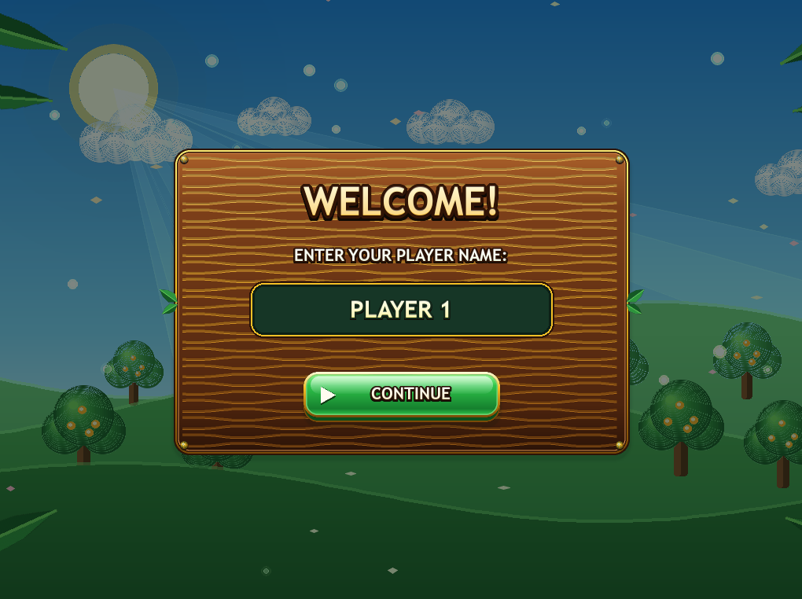
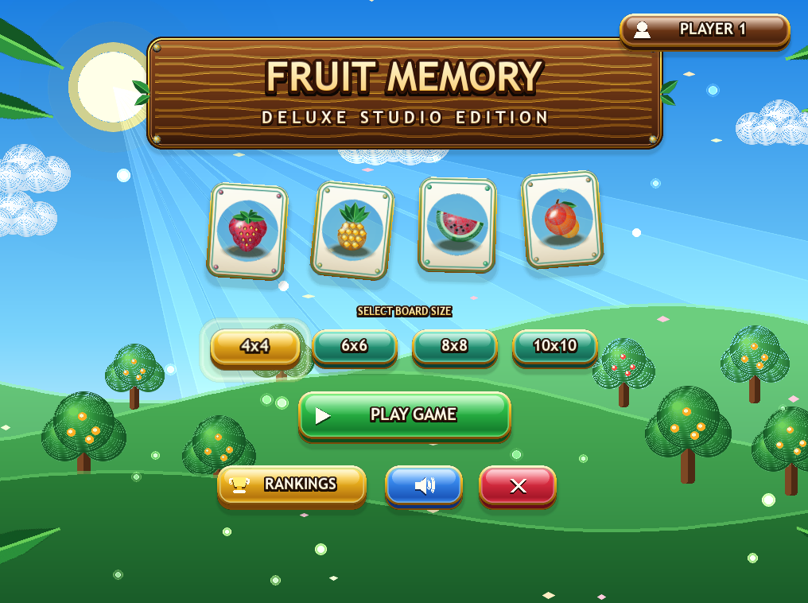
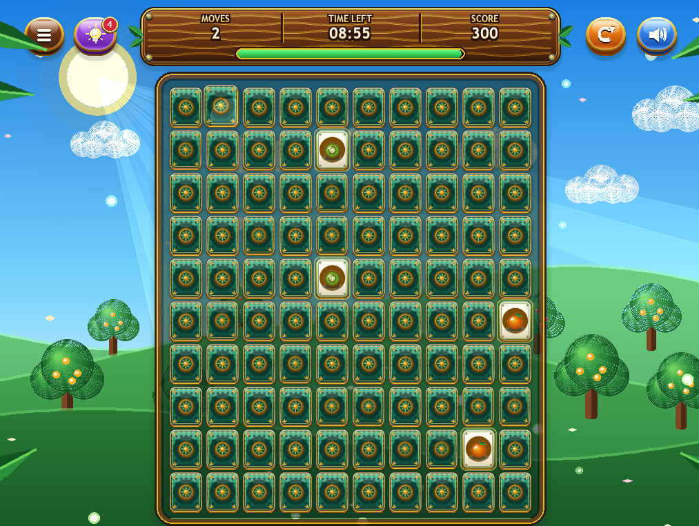
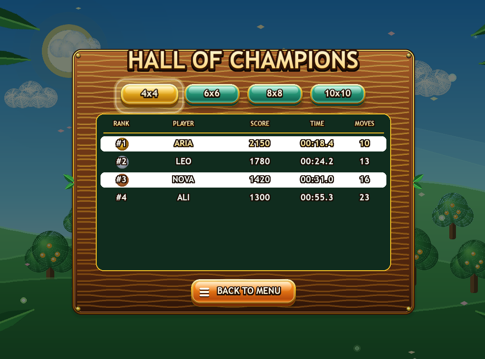

# Fruit Memory Deluxe

## Introduction

When you first open a game, the first screen you will see is the name screen. You can write your name and then go to the main menu.

In the main menu, you can start your game, choose the board size, view the leaderboard, toggle sound on or off, and quit the game.

Turn to gameplay, you will receive many cards but no idea which fruit they have inside. By clicking on one card and then on another card, you can try to find two matching fruits.

If they match, they stay open. But if they don't, they will close again after a while.

You need to remember what fruits you found and where you found them before. It is especially difficult not to get hang of this when you have the option of playing on the bigger board. Number of fruits in board is determined by taking till 64 into consideration.

There is also a timer, so you have to complete the game before the time runs out.

But I wanted to do something which was more than just a simple game on cards. So I made use of variety designs, songs, fruit pictures, changing background and some effects.

There's a place where the scores can be stored. It is the leaderboard, and I think it adds more fun.

## Game Features

The game has many aspects. Some make the game better in terms of performance and some just make them prettier.

- **Four board sizes:** 4x4, 6x6, 8x8 and 10x10.
- **Fruit cards:** The cards depict various fruits.
- **Golden fruits:** There are golden versions of some fruits.
- **Player name:** You can key in your name before you start.
- **Timer:** There is a time limit to find all pairs.
- **Score:** You get points whenever you match two fruits.
- **Combo system:** The more pairs you find without a blunder, the higher the score.
- **Hint button:** Use hints if you forget the card locations.
- **Leaderboard:** You can save your results and see them later.
- **Sound effects:** The game sounds are played when you perform various actions.
- **Card animations:** Cards have flip animations when you click them.
- **Particles:** There are some micro effects that happen when you discover a right pair.
- **Animated background:** Background has moving clouds, hills, leaves and other animated backgrounds.
- **Restart:** You can play again without closing the game.
- **Sound control:** You can turn the sound off or on.

## How to Play

First you need to enter your name. After that the main menu will open. Choose the board size you want and press the play button.

Now all cards are hidden. Click on a card and you will see the fruit. Then click another card and try to find the same fruit.

If you match, they stay open for points. If they are not the same they will close again.

So try to remember where they were because maybe later you will get the other one matching.

Continue this until you have found all the pairs. However, don't let the ticking of the timer disturb your flow. The timer does not stop while you are in the middle of playing.

Successfully find all the pairs before the time runs out? You win. If the time reach zero before you completed all matches, the game will end.

My advice is to not just click on random cards. Try to internalize what you already have. It will help you a lot, specially on the big boards.

## Board Sizes

There are four board sizes in the game. You are able to choose the board size you want in the main menu.

- **4x4:** 16 cards, 8 pairs, 60 seconds.
- **6x6:** 36 cards, 18 pairs, 150 seconds.
- **8x8:** 64 cards, 32 pairs, 300 seconds.
- **10x10:** 100 cards, 50 pairs, 540 seconds.

The 4x4 board is the easiest one as there are just 16 cards, but the difficulties become much greater as you move onto the 10x10 board.

You have 100 cards and have to find 50 pairs.

I added different timers for all boards as they need more time compared to bigger boards. If every single board had the same duration time, it would be jaw-droppingly impossible to finish the big board.

## Scoring System

There are 100 points for every **match**. But in the game there is also a combo system.

It works like this: Find one pair, then another pair without error. Each next match will yield more points than before.

It goes this way:

- First match: 100 points.
- Second match: 200 points.
- Third match: 300 points.
- Fourth match: 400 points.

If you decide to pick two fruits that are not the same, your combo is reset to zero. So, be careful in doing your clicking.

There are also certain changes in the time:

- Correct match gives you 4 advance seconds.
- Wrong match takes from 2 seconds.
- The timer may never be greater than the initial value.

You also get more points for the time you have left when you complete the board. So if you finish sooner you can get more points.

## Star Rating

When you finish a level with the bonuses completed, it will award you 1, 2 or 3 stars. The stars depends on how many attempts you made to find all pairs. Fewer moves means more stars.

- **3 stars:** You used no more than 1.75 times the number of pairs.
- **2 stars:** You used no more than 2.5 times the number of pairs.
- **1 star:** You finished the game but it took more moves.

For example, the 4x4 board has 8 pairs on it, while the 10x10 board has 50. So the game essentially checks the number of moves based on the board size.

## Hint System

Sometimes you just lose track of what a fruit was. This can happen a lot when there are many cards on the screen.

For that I put a hint button. When you tap it, the game will show you a matching pair for a short time. The cards then are hidden again.

You can't use unlimited hints. Each board size has a different number of hints:

- **4x4:** 3 hints.
- **6x6:** 4 hints.
- **8x8:** 5 hints.
- **10x10:** 6 hints.

Try not to use all of the hints at the beginning. Keep them in reserve until you really need some help.

## Leaderboard

There is a leaderboard in the game called **HALL OF CHAMPIONS**.

It saves the player results after winning a game. You can open it from the main menu and check the scores.

The leaderboard saves some information:

- Player name.
- Score.
- Time.
- Number of moves.

Every board size have its own ranking. This is because getting a score on 4x4 is not the same as getting a score on 10x10.

The game saves up to 8 results for each board size. If two players have the same score, the one who finished faster will be higher in the ranking.

The scores are saved in a file called `fruit_memory_leaderboard.json`. You don't need to make this file by yourself. The game will create it when it need to save a result.

## Game Screens

The game features various screens. Each screen is for something different.

### Name Input Screen

The first screen you see after launching the game is this screen. Here you can type your name and proceed.

This name can have at most 12 characters.

### Main Screen

At the Main screen after you go through name screen you can start playing, choose the board size, open leaderboard, change sound, or quit.

### Playing Screen

This is where you play the game itself. All cards, score, time, and number of moves are displayed here.

You also have hint, restart, and menu buttons.

### Victory Screen

This screen is displayed when all matches have been found.

It has the final score, time, moves and record of stars acquired.

### Game Over Screen

This screen gives an option to jump and go back to main menu or play again if your round has ended as the timer hit 0 before you found all the pairs.

### Leaderboard Screen

Game results are here. Change board size to view the top scores.

## Graphics and Animations

I also made various graphics as I was not going to make a simple one.

They are all natural. They have hills, trees and clouds. It looks like there are a lot of other objects as well.

You might also notice that as you play some of them are actually moving. In my opinion it gives the game a more lively feel.

The cards also have their own design. When you click a card, it flips with an animation.

When you find a correct pair, some particles and effects appear on the screen.

Some other effects in the game:

- Clouds and other objects moving in the background.
- Cards flipping when you click them.
- Buttons changing when the mouse is over them.
- Particles when you find a match.
- Small messages showing points and time.
- Shaking effect when you make a wrong match.
- Stars animation when you win.
- Different effects when changing screens.

Most of the graphics are created inside the Python code using Pygame. This means you don't need to download a lot of image files before playing.

## Code and Classes

The entire game is encapsulated within a singular Python file named `fruit_memory_deluxe.py`.

I used separate classes in my code because combining everything into one colossal function would just be a mess. Everything is compartmentalized into different classes that do one job each but work well together.

**Key classes:**

- **FruitMemoryDeluxeGame:** Entrance for the game and all the screens.
- **Card:** Is responsible for the cards and card flip animation.
- **SoundManager:** Plays game sound.
- **ScoresManager:** Loads and creates player scores.
- **AssetGenerator:** Creates fruit pictures and other assets, cards, smooth transitions and backgrounds.
- **ParticleSystem:** Handles all particle effects.
- **Particle:** Helps create a single particle.
- **FloatingPopup:** Shows messages on the screen.
- **ShockwaveRing:** Makes the ring effect.
- **Spring:** For smoother and sharper animations.

The main class is tied into all other classes. Each time something occurs, like checking to see if a match was found, it updates your points, plays a sound, and creates some effects.

All happens together.

## Controls

You can play the game mostly with your mouse. There are not many keyboard controls.

| Input | Action |
|---|---|
| Left Mouse Click | Click cards and buttons. |
| `Enter` | Confirm your name. |
| `Backspace` | Delete a character when typing your name. |
| `Esc` | Go back to the main menu from some screens. |

There are also buttons on the screen for restarting, using hints, changing sound and returning to the menu.

## Built With

I used these tools for making the game:

- **Python 3:** The main language used for the game.
- **Pygame:** Used for the window, graphics, sounds and mouse input.
- **Pygame GFXDraw:** Used for drawing some shapes.
- **JSON:** Used for saving the leaderboard.
- **Python libraries:** Used for random numbers, math, files and other small things.

## Requirements

You need these things to run the game:

- Python 3.
- Pygame.

You don't need to download separate fruit pictures or sound files. The game creates most of these things by itself.

## Installation

First make sure you have Python 3 installed on your computer.

Then open the terminal and install Pygame:

```bash
pip install pygame
```

Wait until the installation is finished. After that you can run the game.

## How to Run

Open the folder where `fruit_memory_deluxe.py` is located.

Then write this command in the terminal:

```bash
python fruit_memory_deluxe.py
```

If your computer uses `python3`, use this command instead:

```bash
python3 fruit_memory_deluxe.py
```

Now the game should open and you will see the name screen.

## Notes

- The game window size is 1024 x 768.
- The game target is 60 FPS.
- The timer starts when you select your first card.
- Player names can have up to 12 characters.
- Scores are saved automatically.
- Every board size has a separate leaderboard.
- You can turn the sound off.
- The leaderboard file is created by the game when needed.

## Future Ideas

I can still add more things to this game later. Maybe more fruits and new card designs. New backgrounds can be nice too.

Another thing I would like to add is a two player mode. Then two people can play together and see who can find the pairs faster.

There are probably many other things that can be improved. For now I wanted to make a memory game that is not only a simple board with cards, but also have some animations and other details.

## License

There is no license file in this project right now. If I want to share the project with other people on GitHub, I can add a license later.

## Screenshots

Here are some pictures from my game.

### Name Input Screen



### Main Menu



### Gameplay




### Leaderboard

